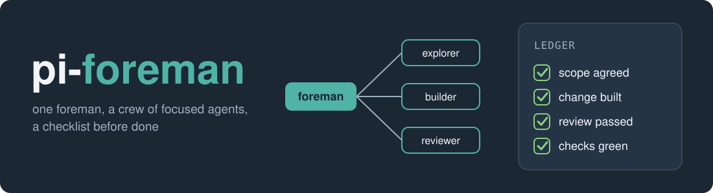

<p>
  
</p>

# pi-foreman

pi-foreman turns the [pi coding agent](https://pi.dev) into a small crew. You talk to one session, the
"foreman". It does not rush into editing your files. It sizes the task, writes down a checklist, hands the
work to focused helper agents (one explores, one builds, one reviews), checks what they bring back, and only
says "done" when the checklist is ticked and a reviewer has passed the change.

What that gives you: fewer wrong edits, a second pair of eyes before anything is called finished, guard rails
around git and the shell, a cost footer so you see what a task used, and the chance to use cheaper models for
the helpers while a stronger one stays in charge.

## Quickstart

Linux, macOS and Windows. Do the four parts in order.

### 1. What you need

| You need | Minimum | What for |
|---|---|---|
| Node.js | 22.19 | Runs Pi and pi-foreman. npm 11.9 to 11.12 cannot install pi-foreman ([fix](docs/install.md#npm-stops-with-eallowgit)). |
| Python | 3.13 | Runs setup, the checklist (the ledger), the config commands and other harness scripts. |
| git | any current version | Pi downloads pi-foreman with it, and the foreman works in git repositories. |
| [Pi](https://pi.dev) | 1.7.x | The coding agent that pi-foreman extends. |
| A model login | | A subscription or an API key for a Pi provider. |
| GitHub CLI `gh` | optional, 2.40 | Only for the pull-request tools (`glab` 1.36 for GitLab). Log in with `gh auth login`. |
| [herdr-app](#herdr-app-recommended) | optional, 0.1.13 | Recommended: a window with one tab per session and a status sidebar. |

Install the first four with the block for your system.

macOS (Homebrew):

```sh
brew install node python@3.13 git
npm install -g @earendil-works/pi-coding-agent@1.7
```

Linux, Debian 13 or Ubuntu 25.04 and later (their `python3` is 3.13). On another distribution, install Node, Python and git with its package manager, then run the last line.

```sh
sudo apt-get update && sudo apt-get install -y curl git python3
curl -fsSL https://deb.nodesource.com/setup_22.x | sudo -E bash - && sudo apt-get install -y nodejs
sudo npm install -g @earendil-works/pi-coding-agent@1.7
```

Windows (PowerShell). Open a new terminal before the last line.

```powershell
winget install Git.Git
winget install OpenJS.NodeJS.LTS
winget install Python.Python.3.13
npm install -g @earendil-works/pi-coding-agent@1.7
```

### 2. Install

Type the first command in a terminal. Then start `pi` and type the others inside Pi.

| Command | What it does |
|---|---|
| `pi install git:github.com/Shredi/pi-foreman` | Downloads pi-foreman and registers it as a Pi package. |
| `/foreman setup --profile standard` | Writes the pi-foreman settings into Pi's agent folder, installs three add-on packages and adds a resume block to your shell profile. Add `--dry-run` to see every change first. It writes nothing then. |
| `/foreman config apply-preset <preset>` | Writes the model map for your subscription. Log in first. The presets are in part 3. |
| `/foreman setup` | Run setup again. It writes the mapped models and their compaction points into Pi's settings. |
| `/foreman doctor` | Checks the install. A line that starts with `FAIL` names what to fix. From a terminal: `bin/foreman doctor` in the package folder. |

Other profiles, flags, add-ons and what setup writes are in [docs/install.md](docs/install.md).

### 3. Pick the preset for your subscription

A preset is a ready model map: it says which model does which job. Log in, then type `/foreman config apply-preset <preset>` and `/foreman setup`.

| You have | Preset | Log in with | Models |
|---|---|---|---|
| Claude Pro or Max | `claude-bridge` | `pi install npm:pi-claude-bridge` (0.11.0 or later), then the [Claude login](docs/install.md#claude-bridge-log-in-once) | Foreman Opus 5.5, helpers Sonnet 5.5 |
| GitHub Copilot | `github-copilot` | `/login` in Pi | Foreman Claude Opus 5.5, reviewer GPT-6.1 Sol, builder and explorer GPT-6 Luna |
| ChatGPT Plus or Pro | `openai-codex` | `/login` in Pi | Foreman GPT-6 Astra, reviewer GPT-6.1 Sol, builder and explorer GPT-6 Luna |
| OpenAI API key (pay per use) | `openai` | `/login` in Pi | Foreman GPT-6 Astra, helpers GPT-6 Luna |
| Google API key (pay per use) | `google` | `/login` in Pi | Foreman Gemini Pro, helpers Gemini Flash |

If your plan lacks a model, edit the ids in `foreman.json` after applying, or apply the preset with `--foreman <provider>/<model>`. All presets and their details are in [docs/presets.md](docs/presets.md).

No preset fits? Write your own model map in `foreman.json`: give the foreman your strongest model and the helpers cheaper ones. The example and the rules are in [docs/install.md](docs/install.md#your-own-model-map).

### 4. First task

1. Start `pi` in a git repository.
2. Type a small task, for example `add a --verbose flag to the CLI`.
3. Watch the foreman work. It sizes the task (trivial, standard or heavy) and writes a checklist, the ledger. A builder makes the change. A reviewer checks it. The foreman says "done" only when the checklist is ticked and the review passed. A footer shows tokens and cost.
4. Type `/foreman close` to end the session cleanly.

Read more: [docs/install.md](docs/install.md) (setup in detail), [docs/features.md](docs/features.md) (every feature and its switch), [docs/roles.md](docs/roles.md) (roles and models). To work on pi-foreman itself, see [Developing](docs/install.md#developing).

### Let your agent do it

Paste this prompt into Pi or another coding agent. It installs and sets up pi-foreman, and it asks you before it changes anything outside Pi's agent folder.

```text
Install and set up pi-foreman (https://github.com/Shredi/pi-foreman) on this machine. It is a package for the pi coding agent. Read the Quickstart in its README first and follow it.

Done means: pi-foreman is installed, setup has run, a model map fits my subscription, and I know what changed.

1. Check what is installed: Node (22.19 or later), npm (not 11.9 to 11.12), Python (3.13 or later, as `python3` or on Windows `py -3`), git, and `pi --version` (1.7.x). Also check the optional tools: `gh` and `herdr-app`. Show me the result as a short table.
2. If a required tool is missing or too old, show me the install command for my system from the README and ask before you run it.
3. Run `pi install git:github.com/Shredi/pi-foreman`.
4. Find Pi's agent folder: the folder in PI_CODING_AGENT_DIR, else `~/.pi/agent` (on Windows `%USERPROFILE%\.pi\agent`). The package is in `<agent folder>/git/github.com/Shredi/pi-foreman`.
5. Run `node <package>/setup.mjs --profile standard --dry-run`. It writes nothing. Tell me in a few lines what it would change: the files in the agent folder, the add-on packages, the block in my shell profile. Ask me, then run it again without `--dry-run`.
6. Ask me which subscription or API key I use. Pick the preset: `claude-bridge` (Claude Pro or Max), `github-copilot`, `openai-codex` (ChatGPT Plus or Pro), `openai` or `google` (API keys). Run `<package>/bin/foreman config apply-preset <preset>` (on Windows `bin\foreman.cmd`), then `node <package>/setup.mjs` again. If no preset fits, leave the model map and show me the part of the README about writing my own map.
7. Check your work: run `node <package>/setup.mjs` once more. Its last line must say "up to date, nothing to change".
8. Run `<package>/bin/foreman doctor` (on Windows `bin\foreman.cmd doctor`). Fix every line that starts with FAIL, or tell me why you cannot.
9. If herdr-app is missing, tell me in two sentences what it adds and ask whether I want it. Its installer downloads a script and runs it, so run it only after I say yes.

Rules, because this is my machine and my accounts:
- Ask before any change outside Pi's agent folder, before any command that needs sudo or administrator rights, and before any command that pipes a download into a shell.
- Do the logins with me, not for me: tell me which login is needed (`/login` inside Pi, or the Claude login from docs/install.md). Do not read or print tokens or keys.
- If a step fails, stop. Show me the error and what you would try next.

Finish with a short report: what you installed, each file you changed and where its backup is, and what I must still do myself. The last step is mine: I start `pi`, log in and type `/foreman doctor`. It also checks the login and the models.
```

### herdr-app (recommended)

[herdr-app](https://github.com/herdrdev/herdr-app) is a desktop app for terminals. With it, a session that the foreman opens starts in the app by itself. A sidebar shows each session's status, open questions and pull requests. Terminals keep running when you close the window, and sessions can run on other machines.

pi-foreman works without it. Then the foreman prints the command for a new session, and you start it in a new terminal yourself. There is no sidebar. Sessions on other machines need the `hc` command, which comes with the app. Pull-request watches get reports only when you run `foreman prs poll` on a timer.

```sh
curl -fsSL https://releases.herdr.dev/app/install.sh | sh    # Linux and macOS (Apple Silicon). Also: brew install --cask herdr-app
irm https://releases.herdr.dev/app/install.ps1 | iex         # Windows (PowerShell)
```

The installers download and run a script, and they also install [herdr-core](https://github.com/herdrdev/herdr-core) (the `hc` command) when it is missing. pi-foreman needs app 0.1.13 with core 0.1.18 or later. The sidebar is a mod that you copy once. The steps are in [docs/herdr.md](docs/herdr.md#herdr-app-and-herdr-core), and `foreman setup --mods` updates it later. The integration is experimental. The older Herdr terminal UI still works ([docs/herdr.md](docs/herdr.md#install)).

## Recommended settings

The defaults suit most setups. Change one when the "when to change" column fits you. Every key is in
[docs/features.md](docs/features.md).

| Setting | Default | When to change |
|---|---|---|
| `compaction.maxTokens` | `200000` | Lower it (minimum 50000) to make Pi compact earlier; `/foreman setup` turns it into Pi's per-model compaction point, so run it again after a change. |
| Cache lifetime and warming, `claude-bridge` | foreman 3600 s, helpers 300 s (`bridge.promptCacheTtl` `1h` / `5m`) | The foreman session is warmed out of the box, so an idle session does not resume cold. Helpers are not warmed unless `providers.claude-bridge.cache.keepalive.children` is `true`. Set `bridge.promptCacheTtl.main` to `5m` on extra-usage credits or an API key, where the 1-hour cache costs more. |
| Cache lifetime and warming, `github-copilot` | warmed for `claude-*` (300 s) and `gpt-*`, `o1*`, `o3*`, `o4*` (1800 s) model ids | Any other Copilot model has no known lifetime and is not warmed; add a `providers.github-copilot.cache.byModel` row with a `ttlSeconds` to warm it. |
| Cache lifetime and warming, every other provider (Anthropic direct included) | no lifetime, no warming | Set both keys below; see the next paragraph. |
| `presence.awayAfterMinutes` | `11` | Minutes without keyboard or mouse input before you count as away; the warming budget is lower while you are. Allowed 1 to 1440. |
| `providers.<p>.roles.<role>.strong.model` | unset | Give a role a stronger second model. A helper climbs to it when its context grows, it runs out of turns or it is stuck, and a builder revision after a failed review goes straight to it. |
| `ladder.strongOnRevision` | `true` | Set `false` to keep a builder on its first model after a failed review. |
| `ladder.strongAbove` | `100000` | Tokens of context growth above a helper's first call before it steps up to its strong model (the explorer's own default is `200000`). |
| `ceremony.default` | `"standard"` | The tier when no signal applies; `/ceremony trivial\|standard\|heavy` sets it yourself. |
| `ceremony.trivialBound` | 2 files, 40 lines, 0 new files | The size of a trivial change; with `ceremony.foremanEdits` `bounded` it is also the most the foreman edits itself. |
| `ceremony.foremanEdits` | `"scratchpad"` | The foreman never changes project files itself; `bounded` lets it make trivial edits within `ceremony.trivialBound`. |

A provider outside that table has no cache lifetime, so nothing warms its idle sessions until you set the
lifetime and the keep-alive. This is easy to miss. In `foreman.json`:

```json
{ "providers": { "my-provider": { "cache": { "ttlSeconds": 600, "keepalive": { "enabled": true } } } } }
```

Use the lifetime your provider documents instead of `600`. Details: [docs/cache.md](docs/cache.md).

## Optional features

- Ready label: mark a pull request that passed review and checks with a label for you to look at, `tools.prReadyLabel` ([docs/tools.md](docs/tools.md#ready-label)).
- High-stakes reviewer: a reviewer launch on risky work can use its own model ([docs/review.md](docs/review.md#high-stakes)).
- Sidebar app: session status in the Herdr sidebar ([docs/herdr.md](docs/herdr.md#install)).
- Remote child sessions (experimental): open a child session on another machine ([docs/sessions.md](docs/sessions.md#remote-child-sessions)).

## Permissions

A tool call that no floor or judge-first entry names simply runs. Only a short list goes to a cheap judge first (losing local work through git, a global install, a curl or wget call that sends data, and a few more); deploys, forge writes, project installs and the like run with no judge call. A judge that does not clear a call refuses it with its reason and nobody is asked; only a judge answer naming one of six danger classes asks you in a dialog. The judge reads no `permissions.json` sentence. Floors for secrets, force pushes, package publishing and the like stay on in every mode. See [docs/permissions.md](docs/permissions.md#who-decides).

## Learn more

| Page | What is in it |
|---|---|
| [docs/install.md](docs/install.md) | Package install, `/foreman setup`, developing, update and remove, config layers, Claude bridge login |
| [docs/roles.md](docs/roles.md) | Roles, model ladder, rank policy, presets |
| [docs/presets.md](docs/presets.md) | Shipped model presets and how to apply them |
| [docs/cache.md](docs/cache.md) | Prompt-cache lifetime, keep-alive, compaction |
| [docs/ceremony.md](docs/ceremony.md) | Tiers, review and finish gates, planning, budgets |
| [docs/safety.md](docs/safety.md) | Shell-write guard, what the gate floors cover for git, the PR gate, the tool gate, known limits |
| [docs/sessions.md](docs/sessions.md) | `/sync`, `/retro`, `/foreman close`, `/foreman session`, intercom, Herdr |
| [docs/herdr.md](docs/herdr.md) | The Herdr sidebar and herdr-app |
| [docs/bench.md](docs/bench.md) | Measuring the harness (bench) |
| [docs/overlays.md](docs/overlays.md) | Private and organisation overlays |
| [docs/development.md](docs/development.md) | Layout, tests, CI, working on pi-foreman |
| [design/architecture.md](design/architecture.md) | The design record and rationale |
| [CHANGELOG.md](CHANGELOG.md) | What changed |

Setting up with an agent: give it the prompt in [Let your agent do it](#let-your-agent-do-it). The feature list for agents is [docs/features.md](docs/features.md).

## License

MIT, see `LICENSE`. Upstream attributions are in `NOTICE`.
