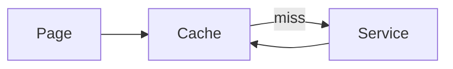

# Cache the price list

## For the owner

**Goal:** The price list loads from a cache, so the shop page opens in under a second.

1. The shop page asks the cache first.
2. On a miss the cache asks the price service and keeps the answer for ten minutes.



|  | Today | After |
| --- | --- | --- |
| Page load | about 4 seconds | under 1 second |
| Price service calls | every visit | once in ten minutes |

> [!NOTE]
> **Decided for you**
>
> - Ten minutes, because prices change a few times a day.

## Work

```ts
const ttl = 600;
```

1. Add the cache.
2. Add a test for a miss and a hit.
