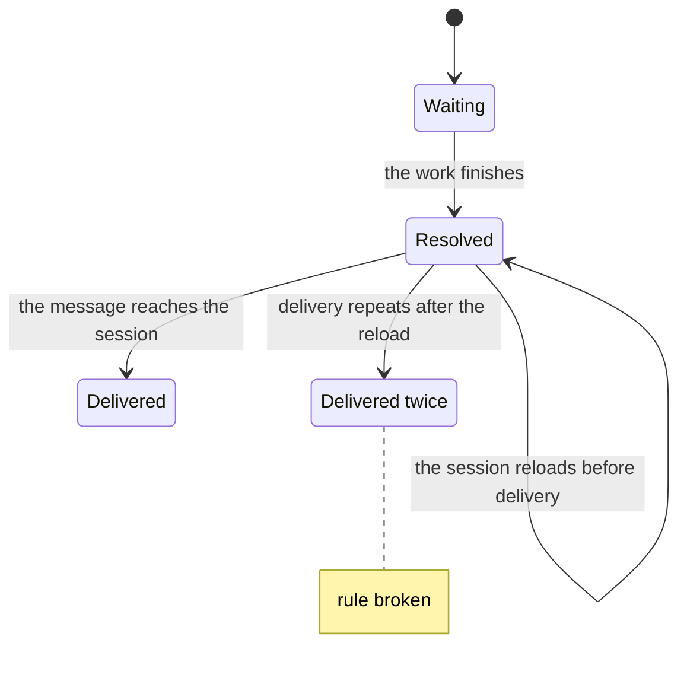

# State-flow checks with TLA+

A model checker answers "does the rule hold in every order the steps can interleave". It fits races, retries, hand-overs, leases, queues and anything with several actors and a lifecycle. It does not check input shapes (use `references/generator-tests.md`) and does not run your code; it runs a small model of it, so the model must be kept true to the code.

## Contents

- When a model fits
- Writing the model
- Running TLC (local opt-in)
- Reading the result
- Drawing the chart
- Replaying the bug path against the code
- Drift and the maintain step

## When a model fits

Use a model when the harm comes from the order or the timing of steps by more than one actor: a late reply, a lost message, two writers, a reload in the middle. Skip it when one function maps inputs to outputs, or when no step can interleave with another. A model costs Java and a learning curve; say in the hand-off why a generator test would not answer the question.

## Writing the model

1. List the steps of the real code that can happen on their own (a message arrives, a timer fires, a process dies, a file is written). Each is one TLA+ action, and each action must correspond to exactly one stretch of code that no other actor can interrupt. If one action stands for several code steps, an interleaving the code allows is missing from the model.
2. List the state the rule talks about, and nothing else. Few variables keep the state space small and the chart readable.
3. Write each rule the reader agreed to as an invariant (a statement true in every reachable state). Write it in the reader's terms first ("a wait that resolves is delivered once"), then as a formula.
4. Keep the constants small (two actors, two messages, one failure). Most order bugs show with two of everything. Raise a bound only when a run is clean and the left-out list needs it covered.
5. Add a fairness or termination assumption only when the rule needs it, and write it in the assumptions list.
6. Keep the model in the repository beside the verify skill, with a comment per action naming the code it stands for (file and function).

## Running TLC (local opt-in)

TLC is the TLA+ model checker. It needs Java 17 or later and `tla2tools.jar` (a download of a few MB from the TLA+ project). Both are installed by hand on the developer machine.

- State the cost in the hand-off: the install size, and the run time with the chosen constants (seconds to minutes).
- The command is local and opt-in. It is never a CI or install dependency unless the owner decides so.
- Typical call: `java -cp tla2tools.jar tlc2.TLC -config Model.cfg Model.tla`. Put the call, the jar location and the constants in the verify skill.
- If Java or the jar is missing, say so; do not substitute a different tool silently.

## Reading the result

- "No error has been found": the rule holds for these constants. It does not hold "in general"; quote the bounds.
- "Invariant ... is violated": TLC prints a trace, the shortest sequence of actions from the start to a bad state (breadth-first search finds a shortest one). That trace is the finding.
- "Deadlock reached": a state with no next step; decide whether it is a bug or a finished run, and say which.
- Never edit the invariant, the constants or an action to make the trace go away. If the trace is wrong, the model is wrong (see replay), and you fix the model to match the code.

## Drawing the chart

The owner judges the rule from a picture, so draw one for each finding. Draw it by hand from the trace and the model's states; no tool does it for you.

- Use Mermaid `stateDiagram-v2`.
- Label states and arrows in the reader's words: what the reader sees ("Waiting", "Reply arrives late", "Delivered twice"), never variable names or action names.
- About 20 arrows at most. Merge states that look the same to the reader; keep only the states on the paths to a broken rule.
- Mark the broken state (for example `note right of X: rule broken: delivered twice`, or a `classDef broken` style).
- Under the chart, write the shortest path to each broken rule as numbered plain steps, one per arrow.

1. The work finishes.
2. The session reloads before the message arrives.
3. The message is sent again and the old one arrives too: delivered twice.

Show the chart to the owner (in this harness: `foreman_show`, or the plan page, which draws Mermaid) and ask whether the rule and the arrows match what they know.

## Replaying the bug path against the code

A counterexample in the model is a claim about the code until the code shows it. For each bug path, write a test that performs the steps in order, one step per action, with the real code under the test's control (a fake clock, an injected failure, a controlled order of two callbacks), and asserts the broken outcome or the rule.

- If the replay shows the bug, it is a finding: report the numbered steps and keep the test as the expected-fail mark (id, source) until the bug is fixed; then it flips into a regression test.
- If the replay does not show the bug, assume the model is wrong until shown otherwise: find the action that has no counterpart in the code (a guard, a lock, an ordering the code enforces), correct the model, rerun TLC. Do not report an unreplayed trace as a bug.

## Drift and the maintain step

A model falls behind the code the day someone changes the code. Counter that with the verify skill:

- list in it the files and functions each action maps to, and the commit last confirmed;
- after a change to a covered file, reread the action comments against the diff, rerun TLC, and replay one old bug path to see the replay test still lines up;
- move the commit forward only after that confirmation;
- when an action in the code is added, removed or split, change the model in the same change as the code.
